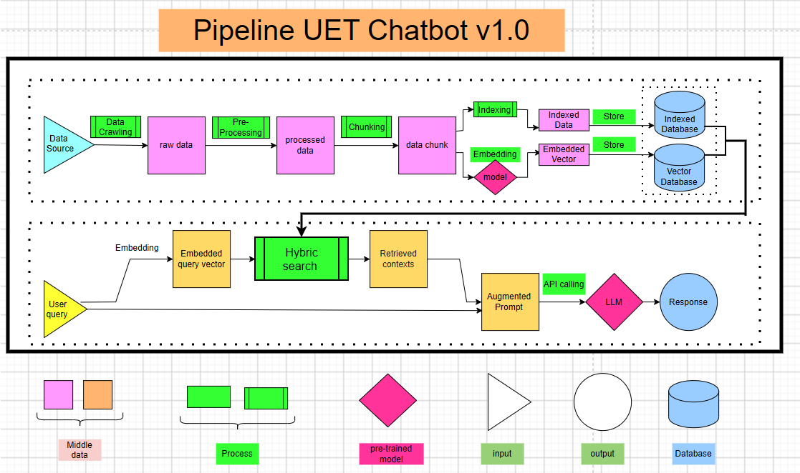

# 🎓 UET Chatbot - Hệ Thống RAG Tra Cứu Quy Chế Đào Tạo (VNU-UET)

Dense ChromaDB and persistent Vietnamese BM25 indexing: see
[indexing usage and lifecycle](src/indexing/README.md).
Knowledge Graph & LightRAG subsystem: see
[graph & LightRAG documentation](src/graph/doc.md).

> **UET Chatbot** là trợ lý ảo AI thông minh ứng dụng công nghệ **RAG (Retrieval-Augmented Generation)** nhằm giải đáp tự động các thắc mắc về học vụ, quy chế đào tạo, điều kiện xét tốt nghiệp, thang điểm rèn luyện và học bổng cho sinh viên **Trường Đại học Công nghệ – ĐHQGHN**.

Dự án được thiết kế theo kiến trúc **Modular RAG** chuẩn kỹ nghệ phần mềm: Toàn bộ hệ thống được module hóa độc lập thông qua "bản giao ước" [`base.py`](base.py), giúp **các thành viên trong nhóm có thể code song song cùng lúc mà không lo xung đột (Git conflict)**.

---

## 📌 Mục Lục
1. [Sơ Đồ Kiến Trúc & Cách Hệ Thống Hoạt Động](#1-sơ-đồ-kiến-trúc--cách-hệ-thống-hoạt-động)
2. [Quy Trình Xử Lý Dữ Liệu Đa Chặng & Cơ Chế Chống Trùng Lặp](#2-quy-trình-xử-lý-dữ-liệu-đa-chặng--cơ-chế-chống-trùng-lặp)
3. [Nguyên Tắc Làm Việc Nhóm Song Song (`base.py`)](#3-nguyên-tắc-làm-việc-nhóm-song-song-bản-giao-ước-basepy)
4. [Hướng Dẫn Từng Bước Dành Cho Thành Viên (Developer Guide)](#4-hướng-dẫn-từng-bước-dành-cho-thành-viên-cách-làm)
5. [Bảng Phân Công Nhiệm Vụ Chi Tiết](#5-bảng-phân-công-nhiệm-vụ-chi-tiết)
6. [Cấu Trúc Thư Mục Dự Án](#6-cấu-trúc-thư-mục-dự-án)
7. [Cài Đặt & Các Lệnh Khởi Chạy Hệ Thống (`main.py`)](#7-cài-đặt--các-lệnh-khởi-chạy-hệ-thống-mainpy)

---

## 1. Sơ Đồ Kiến Trúc & Cách Hệ Thống Hoạt Động

<p align="center">
  
</p>

> 📌 **Ghi chú sơ đồ nguyên lý**: Toàn bộ các khối hình trong sơ đồ trên (*tam giác: Input, hình vuông: Middle Data, hình chữ nhật: Process, hình thoi: Pre-trained Model, hình trụ: Vector Database, hình tròn: Response*) được ánh xạ chính xác 1-1 thành các Model dữ liệu và Lớp trừu tượng trong [`base.py`](base.py).

Hệ thống RAG của chúng ta gồm 2 cỗ máy hoạt động độc lập nhưng bổ trợ cho nhau:

---

## 2. Quy Trình Xử Lý Dữ Liệu Đa Chặng & Cơ Chế Chống Trùng Lặp

Để quản lý kho dữ liệu quy chế học vụ lớn mà không bị nghẽn hoặc xử lý lặp lại nhiều lần, hệ thống phân chia rõ rệt **4 giai đoạn (Stages)** và tích hợp **Sổ cái theo dõi chống trùng lặp (Data Manifest Tracker)**:

### 6 Chặng Dữ Liệu:
1. **`raw`** (`data/raw_data/`): Dữ liệu thô ban đầu (PDF, Word, HTML, văn bản quy chế thu thập được từ cổng thông tin UET).
2. **`processed`** (`data/processed_data/`): Dữ liệu sau khi làm sạch qua [`CleanTextTransformation`](src/ingestion/cleaner.py) (loại bỏ thẻ HTML, ký tự dị biệt, chuẩn hóa khoảng trắng và định dạng UTF-8).
3. **`chunked`** (`data/chunked_data/`): Dữ liệu sau khi được phân đoạn thông minh bởi [`UETChunker`](src/chunking/chunker.py) (kèm đường dẫn phân cấp Breadcrumbs và tuyến tính hóa bảng biểu).
4. **`vectordb`** (`database/vector_db/`): Dữ liệu đã được vector hóa qua `BAAI/bge-m3` ONNX và lưu trữ vào ChromaDB.
5. **`indexed_data`** (`database/bm25_index.pkl`): Chỉ mục từ khóa BM25Plus phục vụ truy vết chính xác mã môn và số quyết định.
6. **`graph_data` / `lightrag`** (`database/graph_index.pkl` & `database/lightrag_db/`): Đồ thị tri thức hợp nhất (Unified GraphRAG) kết hợp thực thể, quan hệ pháp lý và vector đồ thị trong RAM.

### Cơ Chế Chống Trùng Lặp & Cập Nhật Gia Tăng (Deduplication & Incremental Updates):
- Được quản lý bởi lớp [`DataManifestTracker`](src/ingestion/manifest.py) và tệp lưu trữ `data/.ingest_manifest.json`.
- Sử dụng mã băm nội dung **SHA-256** (Content Hash): Khi dữ liệu của một tài liệu hoặc chunk chưa hề thay đổi, hệ thống sẽ **tự động bỏ qua ngay lập tức ($O(1)$)** ở các lần chạy sau, đảm bảo dữ liệu không bị xử lý lặp lại.
- **LightRAG Checkpoint**: Tự động nhận diện tài liệu đã bóc tách đồ thị qua `semantic_units_cache.jsonl` và `graph.json`, bỏ qua tài liệu cũ và chỉ gọi LLM bóc tách cho các văn bản mới thêm vào.

---

## 3. Nguyên Tắc Làm Việc Nhóm Song Song: Bản Giao Ước `base.py`

Để cả nhóm làm việc hiệu quả mà không phụ thuộc vào nhau, dự án áp dụng mô hình **Hợp đồng Lập trình (Interface-driven Development)**:

* 📄 **File [`base.py`](base.py) là BẢN GIAO ƯỚC BẤT BIẾN**:
  - Chứa toàn bộ các **Pydantic Data Models**: `RawData`, `ProcessedData`, `DataChunk`, `EmbeddedVector`, `UserQuery`, `RetrievedContext`, `AugmentedPrompt`, `Response`.
  - Chứa các **Lớp trừu tượng (Abstract Base Classes - ABC)** với các hàm bắt buộc phải cài đặt `@abstractmethod`.
* ⚠️ **QUY TẮC SỐNG CÒN**: **TUYỆT ĐỐI KHÔNG SỬA [`base.py`](base.py)**. 
  - Đầu ra của người này chính là đầu vào của người tiếp theo. Miễn là bạn tuân thủ đúng kiểu dữ liệu trong `base.py`, khi ghép code lại cả hệ thống sẽ chạy mượt mà ngay lập tức!
* 💡 **Code mẫu tham khảo**: Mở file [`examples/mock_pipeline_demo.py`](examples/mock_pipeline_demo.py) để xem cách từng class kế thừa và ghép nối từ A đến Z.

---

## 4. Hướng Dẫn Từng Bước Dành Cho Thành Viên (Cách Làm)

Khi bạn được phân công một phần việc, hãy làm theo đúng 5 bước sau:

### 🔹 Bước 1: Viết code trong thư mục được giao
Ví dụ bạn phụ trách **Chunking**:
1. Mở file [`src/chunking/chunker.py`](src/chunking/chunker.py).
2. Viết class kế thừa từ `BaseChunker`:
   ```python
   from base import BaseChunker, ProcessedData, DataChunk
   from typing import List

   class UETChunker(BaseChunker):
       def chunk(self, doc: ProcessedData) -> List[DataChunk]:
           # Viết thuật toán cắt đoạn văn bản ở đây...
           pass
   ```

### 🔹 Bước 2: Chạy kiểm thử riêng module của mình (Unit Test)
Ở cuối file bạn đang viết, viết khối `if __name__ == "__main__":` để chạy thử xem dữ liệu ra có đúng chuẩn không:
```bash
python src/chunking/chunker.py
```

### 🔹 Bước 3: Ghép vào cỗ máy tổng thể tại `src/pipeline.py`
Mở file [`src/pipeline.py`](src/pipeline.py) (trái tim điều phối của dự án), thay thế class tạm bằng class thật mà bạn vừa viết:
```python
from src.chunking.chunker import UETChunker
```

### 🔹 Bước 4: Chạy kiểm tra End-to-End toàn hệ thống
- **Kiểm thử dòng lệnh**:
  ```bash
  python src/pipeline.py
  ```
- **Chạy toàn bộ bài kiểm thử tự động**:
  ```bash
  python -m unittest discover tests
  ```

## 5. Cấu Trúc Thư Mục Dự Án

```text
UET_chatbot/
├── README.md                 # 📖 Tài liệu hướng dẫn toàn diện này
├── base.py                   # ⚠️ BẢN GIAO ƯỚC CHUNG (Data Models & Abstract Classes)
├── main.py                   # 🚀 ĐIỂM KHỞI CHẠY CHÍNH (Hỗ trợ Web, CLI, Eval, Ingest)
├── config.yaml               # ⚙️ File cấu hình chung (Model, chunk_size, top_k...)
├── requirements.txt          # 📦 Danh sách thư viện Python cần cài đặt
├── .env                      # 🔑 Chứa GEMINI_API_KEY (Không commit lên Git)
├── .env.example              # 📝 File mẫu hướng dẫn tạo .env
├── .gitignore                # 🛡️ Danh sách file bỏ qua trên Git
│
├── database/                 # 🗄️ Thư mục cơ sở dữ liệu cục bộ
│   ├── vector_db/            # Kho lưu trữ ChromaDB (Dense Vector BGE-M3)
│   ├── bm25_index.pkl        # File chỉ mục từ khóa BM25 Index
│   ├── graph_index.pkl       # Cầu nối LightRAGChunkBridge & Regex Supplement
│   └── lightrag_db/          # Đồ thị tri thức LightRAG (graph.json & entity_chroma/)
│
├── src/                      # 💻 MÃ NGUỒN CÁC MODULE CHÍNH
│   ├── pipeline.py           # ⚙️ Trái tim điều phối Ingestion đa chặng & RAG Serving
│   ├── ingestion/            # Module 1: Cào, làm sạch và sổ cái manifest dữ liệu
│   │   ├── loader.py         # Đọc tệp thô (PDF, Word, TXT, HTML)
│   │   ├── cleaner.py        # Làm sạch và chuẩn hóa văn bản
│   │   └── manifest.py       # Sổ cái chống xử lý trùng lặp bằng SHA-256
│   ├── chunking/             # Module 2: Cắt nhỏ văn bản & tuyến tính hóa bảng biểu
│   ├── embeddings/           # Module 3: Vector hóa văn bản (BGE-M3 ONNX)
│   ├── vectordb/             # Module 4: Quản lý ChromaDB & batch upsert
│   ├── indexing/             # Module 5a: Lập chỉ mục BM25Plus & kiểm tra toàn vẹn chunks
│   ├── graph/                # Module 5b: Phân hệ Knowledge Graph & LightRAG (xem src/graph/doc.md)
│   ├── retrieval/            # Module 6: Điều phối 3-Way Retrieval (Router + RRF + Reranker)
│   ├── prompts/              # Module 7: Quản lý mẫu Prompt chuyên gia UET
│   ├── llm/                  # Module 8: Tích hợp đa nhà cung cấp LLM (OpenRouter/Groq/Gemini)
│   ├── evaluation/           # Module 9: Đánh giá chất lượng Retrieval & E2E (Offline + LLM Judge)
│   ├── interfaces/           # Module 10: Tầng giao diện người dùng
│   │   ├── routes.py         # REST API endpoints (/api/chat, /api/health)
│   │   ├── cli.py            # Giao diện dòng lệnh Terminal tương tác trực tiếp
│   │   └── static/           # Giao diện Web HTML/CSS/JS hiện đại
│   └── utils/                # Module 11: Tiện ích logger, đo thời gian, đọc config
│
├── data/                     # 📂 Dữ liệu học vụ UET qua các giai đoạn
│   ├── .ingest_manifest.json # Sổ cái cache chống xử lý lặp lại
│   ├── raw_data/             # 1. Dữ liệu thô gốc (PDF, Word, HTML)
│   ├── processed_data/       # 2. Dữ liệu văn bản đã làm sạch
│   ├── chunked_data/         # 3. Dữ liệu đã chia thành các chunk JSONL
│   └── eval_data/            # 4. Bộ câu hỏi Benchmark QA (test_qa_dataset.json)
│
├── examples/                 # 📚 Code mẫu tham khảo luồng kế thừa
│   └── mock_pipeline_demo.py
└── tests/                    # 🧪 Kiểm thử tự động
    ├── test_app.py
    └── test_ingestion_stages.py
```

---

## 6. Cài Đặt & Các Lệnh Khởi Chạy Hệ Thống (`main.py`)

### 1. Cài đặt môi trường ban đầu
```bash
# 1. Tạo môi trường ảo Python
python -m venv .venv

# 2. Kích hoạt môi trường (Windows PowerShell)
.venv\Scripts\Activate.ps1

# 3. Cài đặt các thư viện cần thiết
pip install -r requirements.txt

# 4. Tạo file cấu hình .env từ file mẫu
cp .env.example .env
```
👉 Mở file `.env` và điền `GEMINI_API_KEY` của bạn (Lấy miễn phí tại [Google AI Studio](https://aistudio.google.com/app/apikey)).

---

### 2. Các Lệnh Điều Phối Dữ Liệu (Multi-stage Data Ingestion)

#### 📊 Xem báo cáo thống kê dữ liệu 5 chặng & Sổ cái manifest
```bash
python main.py --ingest --status
```
Lệnh này sẽ in ra số lượng file tại `raw`, số văn bản tại `processed`, số chunks tại `chunked`, số vectors trong `database/vector_db` cùng tiến độ của sổ cái chống trùng lặp.

#### ⚙️ Quy trình nạp mới toàn bộ dữ liệu (Khi có dữ liệu mới / cập nhật)
Khi có dữ liệu mới và cần làm mới lại từ đầu cả Dense Vector DB (ChromaDB) và BM25 Sparse Index, bạn thực hiện chuẩn xác theo **2 bước tuần tự** sau:

- **Bước 1: Cắt chunking, embedding và nạp vào ChromaDB (Làm mới sạch sẽ)**:
  ```bash
  python main.py --ingest --from processed --to vectordb --clear
  ```
  * **Cờ `--clear`**: Tự động xóa manifest tracking (chặng `chunked`, `vectordb`), dọn sạch các file cũ trong folder `data/chunked_data` và xóa toàn bộ vectors trong ChromaDB.
  * **Thực thi**: Cắt chunk dữ liệu mới và nhúng vector BGE-M3 nạp vào ChromaDB.
  *(Nếu muốn chạy từ dữ liệu thô ban đầu thì thay `--from processed` bằng `--from raw`).*

- **Bước 2: Xây dựng chỉ mục từ khóa BM25 (Sparse Index)**:
  ```bash
  python main.py --ingest --from chunked --to indexed_data --clear
  ```
  * **Cờ `--clear`**: Tự động xóa file `database/bm25_index.pkl` cũ và xóa manifest tracking chặng `indexed_data`.
  * **Thực thi**: Đọc các chunk vừa tạo từ Bước 1, kiểm tra khớp 100% với ChromaDB và dựng chỉ mục BM25 mới.

- **Bước 3: Xây dựng chỉ mục đồ thị tri thức hợp nhất (Unified GraphRAG Index)**:
  ```bash
  python main.py --ingest --from chunked --to graph_data --clear
  ```
  * **Thực thi (0-LLM, ~1 phút)**: Nạp toàn bộ chunks trong RAM, hợp nhất tri thức từ LightRAG (nút, cạnh, tóm tắt), vector hóa cạnh quan hệ và lưu ra `database/graph_index.pkl`.

---

#### 📌 Các lệnh nạp theo từng chặng lẻ khác
- **Từ dữ liệu thô `raw` sang dữ liệu sạch `processed`**:
  ```bash
  python main.py --ingest --from raw --to processed
  ```

- **Từ dữ liệu thô `raw` sang `chunked`** (tự động trải qua bước làm sạch trung gian):
  ```bash
  python main.py --ingest --from raw --to chunked
  ```

- **Trích xuất đồ thị tri thức LightRAG cho tài liệu mới (không dùng cờ `--clear`)**:
  ```bash
  python main.py --ingest --from processed --to lightrag
  ```
  *(Tự động bỏ qua các tài liệu đã có trong đồ thị, chỉ gọi LLM trích xuất cho các tài liệu mới thêm).*

- **Tái tạo nhanh file BM25 từ chunk có sẵn**:
  ```bash
  python main.py --ingest --from chunked --to indexed_data
  ```

---

### 3. Các Lệnh Trải Nghiệm & Đánh Giá Chatbot

#### 🌟 1. Khởi chạy Giao diện Web (Khuyên Dùng)
```bash
python main.py --run --web
```
- Mở trình duyệt tại `http://127.0.0.1:8000`.
- Giao diện chat hiện đại, hỗ trợ gợi ý câu hỏi, popup xem trích dẫn tài liệu quy chế UET.
- Xem tài liệu Swagger REST API tại: `http://127.0.0.1:8000/docs`.

#### 💻 2. Khởi chạy Chatbot trên Terminal (CLI Mode)
```bash
python main.py --run --cli
```
- Tương tác hỏi đáp tức thì ngay trên cửa sổ dòng lệnh.
- Các lệnh hữu ích khi chat: `stats` (thống kê vector), `clear` (xóa màn hình), `exit` (thoát).

#### 📊 3. Chấm điểm chất lượng hệ thống (Evaluation)
- **Đánh giá toàn trình RAG End-to-End** (tính toán bộ metrics RAG Triad: Faithfulness, Answer Relevance, Context Relevance):
  ```bash
  python main.py --eval --e2e
  ```
- **Đánh giá riêng hiệu quả phân hệ truy xuất Retrieval** (tính toán Precision@K, Recall@K, NDCG@K, MRR, MAP trên 50 queries benchmark):
  ```bash
  python main.py --eval --retrieval
  ```

---

> 💡 **Dành cho lập trình viên:**
> - Kiểm tra toàn bộ Unit Test: `python -m unittest discover tests`
> - Kiểm tra riêng các giai đoạn Ingestion: `python -m unittest tests/test_ingestion_stages.py`
> - Đọc code mẫu ghép nối các lớp: `python examples/mock_pipeline_demo.py`
