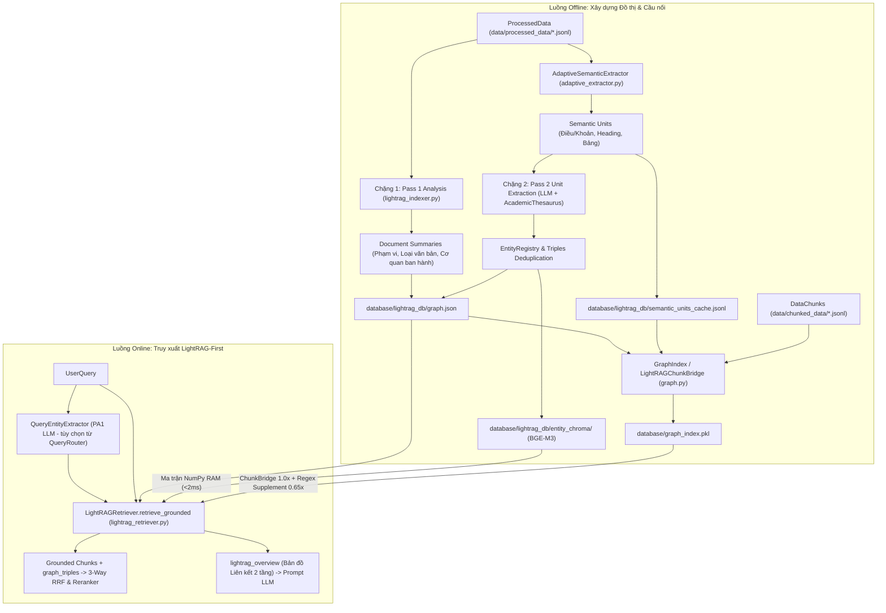

# Tài Liệu Kỹ Thuật Phân Hệ Knowledge Graph & LightRAG (`src/graph`)

Phân hệ `src/graph` đóng gói toàn bộ logic **Đồ thị Tri thức (Knowledge Graph) & LightRAG** theo kiến trúc **LightRAG-First** khép kín, từ giai đoạn trích xuất offline đến truy xuất online 2 tầng.

> **Nguyên tắc kiến trúc (One-Way Dependency):**
> - `src/graph/` là phân hệ độc lập, **không phụ thuộc ngược lại `src/retrieval/`**.
> - `src/pipeline.py` gọi `src/graph/` để xây dựng `database/lightrag_db/` và `database/graph_index.pkl`.
> - `src/retrieval/` gọi `src/graph/` như **Nhánh 3 (Knowledge Graph)** ngang hàng với `BM25` (`src/indexing/sparse.py`) và `Dense Vector` (`src/vectordb/`).

---

## 1. Cấu Trúc Thư Mục `src/graph/`

```text
src/graph/
├── __init__.py                 # Lazy exports cho toàn bộ public API của phân hệ Graph/LightRAG
├── academic_thesaurus.json     # Từ điển học vụ UET: 169 thực thể chuẩn & 2.361 biến thể/aliases
├── thesaurus_utils.py          # Chuẩn hóa O(1) alias -> canonical name & lọc FORBIDDEN_ENTITIES
├── adaptive_extractor.py       # Gom văn bản thành Semantic Units theo Điều/Khoản/Heading/Bảng
├── lightrag_indexer.py         # Pipeline trích xuất đồ thị 2 chặng (Pass 1 + Pass 2) -> lightrag_db/
├── graph.py                    # LightRAGChunkBridge (GraphIndex) + Regex/Vector Supplement -> graph_index.pkl
├── query_entity_extractor.py   # Bộ bóc tách thực thể câu hỏi 2 tầng bằng LLM (PA1) kèm LRU Cache & Timeout
├── lightrag_retriever.py       # Động cơ truy xuất đồ thị chính (Primary Dual-Level Retriever + Dual-Output)
└── doc.md                      # Tài liệu đặc tả kỹ thuật này
```

---

## 2. Luồng Dữ Liệu Tổng Thể (Offline Indexing & Online Retrieval)



---

## 3. Chi Tiết Các Thành Phần

### 3.1. Từ Điển Học Vụ Academic Thesaurus (`academic_thesaurus.json` & `thesaurus_utils.py`)
- **Quy mô:** **169 thực thể pháp lý chuẩn hóa** và **2.361 biến thể / aliases** tiếng Việt học vụ UET.
- **Chức năng chính:**
  - Tra cứu $O(1)$ chuẩn hóa cách gọi tương đương, viết tắt và khẩu ngữ về dạng chính tắc (*"tạch môn"* → *"Học lại"*, *"học song bằng"* → *"Học cùng lúc hai chương trình đào tạo"*, *"CN8"* → *"Khoa học máy tính"*, *"FIT"* → *"Khoa Công nghệ thông tin"*...).
  - Khử siêu nút nhiễu thông qua `FORBIDDEN_ENTITIES` (dùng khi xây đồ thị) và `EXTENDED_FORBIDDEN_ENTITIES` (dùng khi chọn hạt giống truy vấn, chặn thêm các từ quá chung như *"uet", "đhqghn", "quy chế", "sinh viên"*).

---

### 3.2. Bộ Gom Cụm Ngữ Nghĩa Thích Ứng (`adaptive_extractor.py`)
Thay vì cắt vụn theo kích thước cố định, `AdaptiveSemanticExtractor` phân tách `ProcessedData` thành các `SemanticUnit` toàn vẹn ngữ nghĩa (`MAX_UNIT_CHARS = 3000`, `MIN_UNIT_CHARS = 50`):
- `LEGAL_ARTICLE`: Gom trọn vẹn từng **Điều** (bao gồm các Khoản) của văn bản quy chế.
- `HEADING_SECTION`: Gom theo phân cấp Heading Markdown (`#`, `##`, `###`).
- `TABLE_UNIT`: Đóng gói bảng tra cứu (điểm chuẩn, học phí, chuẩn ngoại ngữ) giữ nguyên ngữ cảnh cột/dòng.
- `PARAGRAPH_UNIT`: Gom theo đoạn văn hoàn chỉnh (`\n\n`) cho văn bản tự sự.

---

### 3.3. LightRAG Knowledge Graph Indexer (`lightrag_indexer.py`)
Trích xuất đồ thị tri thức đa chặng theo kiến trúc **Hierarchical 2-Pass Extraction** với **Closed Relation Schema** (12 loại quan hệ pháp quy: `quy_định_bởi`, `điều_kiện_tiên_quyết`, `ngoại_lệ_cho`, `dẫn_chiếu_đến`, `chế_tài_xử_lý`, `áp_dụng_cho`, `bổ_sung_cho`, `thay_thế_bởi`, `liên_quan_đến`, `thuộc_về`, `quản_lý_bởi`, `bao_gồm`):
1. **Chặng 1 (Document-level Pass 1):** Phân tích phần mở đầu văn bản để tạo `document_summaries` và trích xuất Root Entities.
2. **Chặng 2 (Unit-level Pass 2):** Trích xuất thực thể & quan hệ chi tiết trên từng `SemanticUnit`, chuẩn hóa qua `AcademicThesaurus`, chống trùng lặp qua `EntityRegistry`, và liên kết về Root Entities.
3. **Lưu trữ & Vector hóa thực thể:** Xuất `database/lightrag_db/graph.json`, `semantic_units_cache.jsonl` và upsert vector BGE-M3 vào `database/lightrag_db/entity_chroma/`.
4. **Cơ chế Checkpoint & Cập nhật gia tăng (Resume):** Khi chạy không kèm `--clear`, hệ thống đọc `processed_doc_ids` từ `semantic_units_cache.jsonl`, bỏ qua tức thì ($0\text{ms}$) các văn bản đã xử lý và chỉ gọi LLM cho văn bản mới.

---

### 3.4. Cầu Nối Chunk & Bộ Bổ Khuyết Regex/Vector (`graph.py`)
Lớp `GraphIndex` (với các alias `LightRAGChunkBridge` và `RegexSupplementGraph`, lưu tại `database/graph_index.pkl`) đóng vai trò **cầu nối phụ trợ** cho `LightRAGRetriever`:
1. **Ánh xạ Subgraph LightRAG về `DataChunk` gốc (`ground_lightrag_subgraph`):**
   - Nạp thực thể, cạnh quan hệ và tóm tắt từ `database/lightrag_db/graph.json` và `semantic_units_cache.jsonl`.
   - Ánh xạ 2 mức trọng số về `chunked_data`: **Primary Weight (`1.0x`)** cho chunk chứa bằng chứng trực tiếp; **Secondary Weight (`0.25x`)** cho các chunk cùng Điều/Heading.
2. **Thống kê độ hiếm & khử nhiễu:** Tính `Entity IDF`, chặn lan truyền qua siêu nút (`Hub Gating` theo `max_hub_df`), thưởng **Co-Activation / Bridging Bonus** khi một chunk nối $\ge 2$ thực thể truy vấn, và làm mượt điểm sang chunk liền kề (`Adjacent Structural Smoothing`).
3. **Bổ khuyết độ phủ Regex & Vector (`supplement_weight = 0.65x`):** Nhận diện mã học phần (`INT3401`, `EMA2010`), số hiệu văn bản (`5115/QĐ-ĐHQGHN`) và các chunk mới chưa chạy LLM `LightRAGIndexer`, bổ sung dưới trần ưu tiên `1.0x` của LightRAG.
4. **Đính kèm `graph_triples`:** Gắn các bộ ba quan hệ kèm trích dẫn căn cứ vào `metadata["graph_triples"]` của `RetrievedContext` để bảo toàn ngữ nghĩa qua 3-Way RRF và Cross-Encoder Reranker.
5. **Tương thích ngược Pickle (`_CompatGraphUnpickler`):** Tự động ánh xạ đường dẫn module cũ `src.indexing.graph` → `src.graph.graph` trong `GraphIndex.load()`, cho phép nạp nguyên vẹn các artifact `database/graph_index.pkl` đã build trước đó mà không cần dựng lại.

---

### 3.5. Bộ Bóc Tách Thực Thể Câu Hỏi PA1 (`query_entity_extractor.py`)
`QueryEntityExtractor` phân tách câu hỏi người dùng thành 2 tầng JSON chuẩn LightRAG khi được `QueryRouter` kích hoạt (chạy song song đa luồng cùng BM25 + Vector trong `UETRetriever`):
- **`low_level_entities`** (tối đa 5–6 mục): Thực thể học vụ cụ thể (ngành, mã ngành, học bổng, chứng chỉ, trạng thái học vụ...).
- **`high_level_themes`** (tối đa 3–4 mục): Chủ đề quy chế / quy trình tổng quát.
- Tự động dịch khẩu ngữ/tiếng lóng sinh viên sang thuật ngữ chuẩn UET, lọc sạch `EXTENDED_FORBIDDEN_ENTITIES`, tích hợp **In-memory LRU Cache** thread-safe, timeout chặt (`llm_extraction_timeout: 3.5s`) và fallback an toàn sang PA2 (0-LLM) nếu LLM gặp lỗi.

---

### 3.6. Động Cơ Truy Xuất Đồ Thị Chính (`lightrag_retriever.py`)
`LightRAGRetriever` thực hiện truy xuất đồ thị 2 tầng và cơ chế **Xuất Kép (Dual-Output)** qua `retrieve_grounded(...)`:
1. **Semantic Entity Resolution siêu tốc (`<2ms`):** Nạp sẵn vector thực thể BGE-M3 (1024-d) từ `entity_chroma` lên ma trận NumPy RAM để khớp thực thể ngữ nghĩa (ngưỡng cosine $\ge 0.72$).
2. **Low-level Retrieval:** Lan truyền kích hoạt có trọng số trong bán kính 1–2 hops theo trọng số pháp lý `LIGHTRAG_RELATION_WEIGHTS` (ưu tiên `điều_kiện_tiên_quyết`, `ngoại_lệ_cho`, `chế_tài_xử_lý`, `bổ_sung_cho`, `thay_thế_bởi`), kết hợp `LIGHTRAG_CATEGORY_WEIGHTS`, `Entity IDF` và `Hub Gating`.
3. **High-level Retrieval:** Khai thác các bản tóm tắt tài liệu toàn cục (Pass 1) theo `high_level_themes`.
4. **Dual-Output (`retrieve_grounded`):**
   - **`Grounded Chunks`:** Gọi `LightRAGChunkBridge.ground_lightrag_subgraph(...)` trả về `List[RetrievedContext]` chứa `DataChunk` nguyên văn (kèm `metadata["graph_triples"]`) để hợp nhất vào 3-Way RRF & Jina Reranker.
   - **`lightrag_overview`:** Tổng hợp *Bản đồ Liên kết Quy chế 2 tầng* ngắn gọn (`synthesis_max_chars = 900`) đính kèm lên chunk hạng 1 để bơm trực tiếp vào đầu Prompt LLM đối với các câu hỏi quan hệ/đa thực thể.

---

## 4. Cấu Hình (`config.yaml`) & Lệnh Vận Hành

### Tham số chính trong `config.yaml`
```yaml
paths:
  graph_index_file: "database/graph_index.pkl"
  graph_llm_cache_file: "database/graph_llm_cache.json"

graph:
  merge_lightrag_kg: true          # Hợp nhất graph.json + entity_chroma vào graph_index.pkl
  auto_sync_on_reindex: true       # Tự đồng bộ lại graph_index.pkl (0-LLM) khi cập nhật indexed_data
  enable_llm_extraction: false     # Không gọi LLM lẻ từng chunk vì đã có đồ thị 2-Pass từ LightRAG
  max_hops: 2
  hop_decay: 0.65
  seed_top_m: 10

lightrag:
  enabled: true
  graph_path: "database/lightrag_db/graph.json"
  entity_vector_dir: "database/lightrag_db/entity_chroma"
  thesaurus_file: "src/graph/academic_thesaurus.json"
  semantic_units_cache: "database/lightrag_db/semantic_units_cache.jsonl"
  retrieval_mode: "hybrid"
  max_entities_per_query: 15
  subgraph_depth: 2
  supplement_weight: 0.65
  enable_synthesis_overview: true
  synthesis_max_chars: 900
  use_llm_query_extraction: true
  llm_extraction_timeout: 3.5
  entity_similarity_threshold: 0.72
  entity_vector_top_k: 3
```

### Lệnh CLI & Kiểm Thử
```bash
# 1. Trích xuất / cập nhật gia tăng đồ thị LightRAG cho tài liệu mới (có checkpoint):
python main.py --ingest --from processed --to lightrag

# 2. Xây dựng / đồng bộ cầu nối LightRAGChunkBridge (0-LLM, ~1 phút -> database/graph_index.pkl):
python main.py --ingest --from chunked --to graph_data --clear

# 3. Chạy bộ kiểm thử đơn vị & tích hợp của phân hệ Graph / LightRAG:
pytest tests/test_graph_rag.py tests/test_lightrag_pa1.py -q
```
