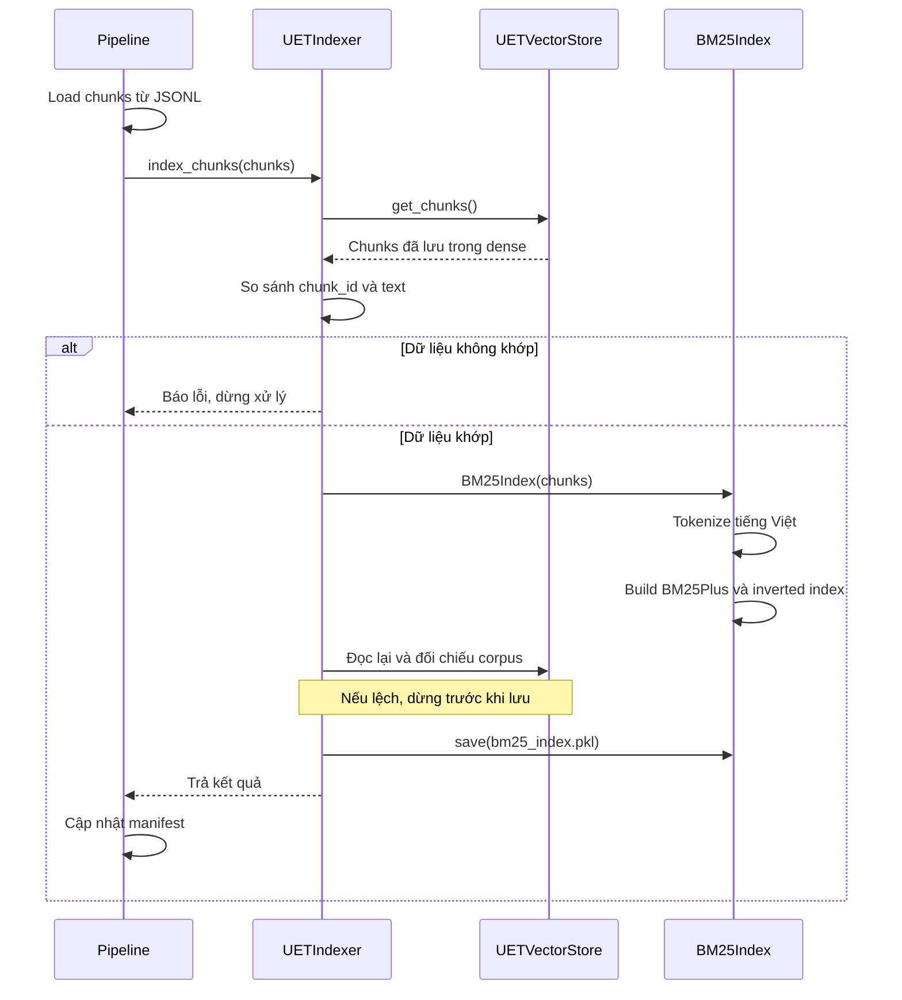

# Indexing

Module indexing xây dựng **BM25Plus và inverted index** từ dữ liệu trong `data/chunked_data/*.jsonl`.

Trước khi build, `UETIndexer` đối chiếu toàn bộ `chunk_id` và `text` của chunks với dữ liệu trong `UETVectorStore`. Thứ tự chunks không ảnh hưởng kết quả.

- **Khớp:** build BM25, kiểm tra lại với dense rồi lưu vào `database/bm25_index.pkl`.
- **Không khớp:** báo lỗi, giữ nguyên artifact BM25 cũ.
- Không tạo embedding hoặc thay đổi dữ liệu trong VectorStore.

## Trình tự thực hiện



## Sử dụng

Chạy dense trước, sau đó chạy sparse trên cùng bộ chunks:

```bash
python main.py --ingest --from chunked --to vectordb
python main.py --ingest --from chunked --to indexed_data
```

| File | Vai trò |
|---|---|
| `chunks.py` | Nạp và chuẩn hóa chunks từ JSONL |
| `indexer.py` | Đối chiếu với dense, điều phối build và lưu BM25 |
| `sparse.py` | Tokenization, BM25Plus, inverted index, lưu/load và tìm kiếm |

Retrieval nạp artifact đã xây để tìm kiếm, không build lại index. Kiểm tra đồng bộ chỉ đối chiếu **ID và text**, không đánh giá chất lượng embedding.