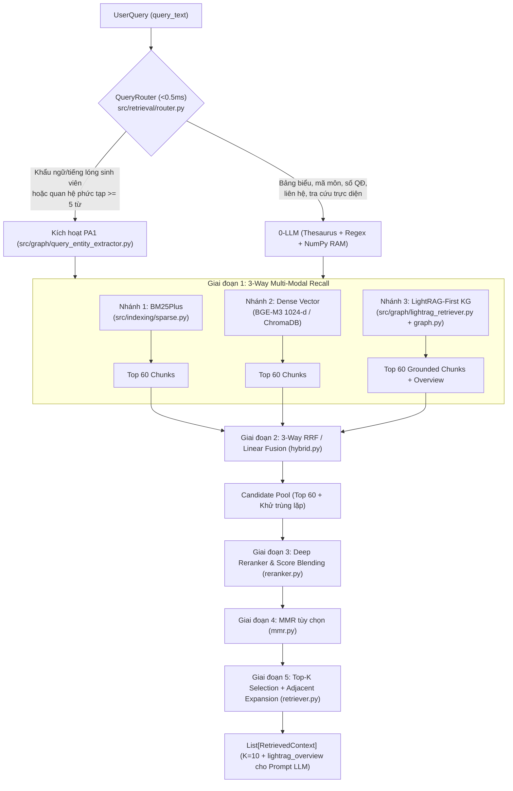

# Tài Liệu Kỹ Thuật Phân Hệ Retrieval (Điều Phối Truy Xuất Đa Nhánh)

Tài liệu này mô tả kiến trúc, thuật toán và luồng điều phối của phân hệ **`src/retrieval/`** trong dự án UET Chatbot: tiếp nhận `UserQuery`, phân luồng qua **`QueryRouter`**, gọi song song **3 nhánh tìm kiếm (`BM25` + `Dense Vector` + `Knowledge Graph / LightRAG`)**, hợp nhất **3-Way RRF**, tái xếp hạng bằng **Deep Cross-Encoder Reranker**, và mở rộng ngữ cảnh liền kề.

> **Lưu ý kiến trúc:** Chi tiết thuật toán nội bộ của nhánh đồ thị tri thức (`LightRAGRetriever`, `QueryEntityExtractor`, `LightRAGChunkBridge`, `AcademicThesaurus`) được quản lý độc lập tại [`src/graph/doc.md`](../graph/doc.md). Phân hệ `src/retrieval/` chỉ đóng vai trò **điều phối đa nhánh (orchestration)** và gọi `src/graph/` theo 1 chiều.

---

## 1. Kiến Trúc Luồng Điều Phối (3-Way Retrieval Pipeline)

Phân hệ tiếp nhận câu hỏi người dùng (`UserQuery`) và trả về danh sách $K$ đoạn văn bản liên quan nhất (`List[RetrievedContext]`) thông qua 5 giai đoạn:



---

## 2. Chi Tiết Các Thành Phần Trong `src/retrieval/`

### 2.1. Bộ Định Tuyến Thông Minh `QueryRouter` (`src/retrieval/router.py`)
`QueryRouter` phân tích đặc trưng câu hỏi trong $<0.5\text{ms}$ (không gọi LLM) để:
1. **Định tuyến động cơ (`route`):** Chọn `"vector"`, `"hybrid"` hoặc `"lightrag"` dựa trên cấu hình `lightrag.router.mode` và mật độ thực thể/từ khóa quan hệ (`RELATIONAL_PATTERNS`, `PASSAGE_PATTERNS`).
2. **Kích hoạt thông minh PA1 (`should_use_llm_extraction`):**
   - **Bật PA1 (`True`):** Khi gặp khẩu ngữ/tiếng lóng sinh viên (`COLLOQUIAL_SLANG_PATTERNS`: *"tạch", "nợ môn", "rớt môn", "bảo lưu", "song bằng", "ra trường"...*) hoặc câu hỏi quan hệ học vụ $\ge 5$ từ. `UETRetriever` chạy song song PA1 với BM25 + Vector bằng `ThreadPoolExecutor(max_workers=2)`.
   - **Tắt PA1 (`False` → 0-LLM `<15ms`):** Khi tra cứu bảng điểm/số liệu (`TABULAR_OR_CODE_PATTERNS`: *"điểm chuẩn", "điểm sàn", "chỉ tiêu", "học phí"*), mã môn/số QĐ, hoặc địa chỉ/liên hệ đơn thuần.

---

### 2.2. Điều Phối 3 Nhánh Truy Xuất (`src/retrieval/retriever.py`)
`UETRetriever` kết hợp 3 nguồn ứng viên:
1. **Nhánh 1 — BM25Plus (`src/indexing/sparse.py`):** Bắt chính xác từ khóa, mã học phần và số hiệu quyết định.
2. **Nhánh 2 — Dense Vector (`src/embeddings/embedder.py` + `src/vectordb/`):** Nắm bắt ngữ nghĩa bằng `BAAI/bge-m3` (1024 chiều).
3. **Nhánh 3 — Knowledge Graph / LightRAG (`src/graph/`):** Gọi `LightRAGRetriever.retrieve_grounded(...)` (đã gắn cầu nối `LightRAGChunkBridge`) lấy về `Grounded Chunks` (kèm `metadata["graph_triples"]`) và khối `lightrag_overview` (đính lên chunk hạng 1 cho các câu hỏi quan hệ). Xem chi tiết tại [`src/graph/doc.md`](../graph/doc.md).

---

### 2.3. Hợp Nhất Đa Nhánh 3-Way Fusion (`src/retrieval/hybrid.py`)
`HybridSearcher` hợp nhất ứng viên từ 3 nhánh theo **Reciprocal Rank Fusion (RRF)** hoặc tổ hợp tuyến tính:

$$\text{Score}_{RRF}(d) = \frac{w_{bm25}}{k + \text{rank}_{bm25}(d)} + \frac{w_{vec}}{k + \text{rank}_{vec}(d)} + \frac{w_{graph}}{k + \text{rank}_{graph}(d)}$$

- Cấu hình mặc định hiện hành (`config.yaml`): $k = 30$, $w_{bm25} = 0.60$, $w_{vec} = 0.20$, $w_{graph} = 0.30$ (tự động tăng lên `lightrag_hybrid_weight = 0.40` với câu hỏi quan hệ không phải tra cứu bảng số).
- Hợp nhất `metadata` (giữ nguyên `graph_triples`, `graph_entities`, `search_source`) khi cùng một `chunk_id` xuất hiện trên nhiều nhánh.

---

### 2.4. Tái Xếp Hạng Sâu & Hòa Trộn Điểm (`src/retrieval/reranker.py` & `retriever.py`)
- **Mô hình chính:** `JinaONNXReranker` (`jina-reranker-v2-base-multilingual` chạy ONNX Runtime GPU/CPU theo micro-batch).
- **Dự phòng:** `ViRankerReranker`, `CrossEncoderReranker`, `FlashRankReranker`, `HeuristicReranker`.
- **Bảo toàn ngữ nghĩa đồ thị:** Đính kèm cạnh quan hệ từ `metadata["graph_triples"]` khi chấm Cross-Encoder để giữ điểm cao cho các chunk được bắc cầu qua khẩu ngữ.
- **Score Blending & Entity Anchor Boost (`_blend_rerank_and_hybrid`):** Hòa trộn `0.65 * rerank_score + 0.35 * hybrid_score` và cộng/trừ nhẹ khi khớp chính xác năm (`2025`/`2026`), mã học phần/số QĐ hoặc thực thể PA1.

---

### 2.5. Lọc Đa Dạng MMR & Mở Rộng Ngữ Cảnh Liền Kề (`src/retrieval/mmr.py` & `retriever.py`)
- **Maximal Marginal Relevance (`mmr.py`):** Cân bằng độ liên quan và độ đa dạng (`mmr_stage: "post_rerank"`, `mmr_lambda: 0.75`, `mmr_similarity_threshold: 0.92`, `mmr_protect_tabular: true` để không phạt nhầm các chunk cùng bảng biểu; mặc định đang tắt để ưu tiên giữ trọn chunk bảng/quy chế).
- **Adjacent Chunk Expansion (`_expand_adjacent_chunks` trong `retriever.py`):** Tự động gộp các chunk liền kề (`±1`) cho Top-3 chunk điểm cao nhất trong cùng tài liệu nhằm tránh đứt đoạn điều khoản dài hoặc bảng biểu, đồng thời giữ nguyên `chunk_id` và thứ hạng phục vụ đánh giá IR.

---

## 3. Cấu Trúc Thư Mục `src/retrieval/`

```text
src/retrieval/
├── __init__.py     # Xuất API điều phối: UETRetriever, QueryRouter, HybridSearcher, MMR, RerankerFactory
├── router.py       # QueryRouter: Phân luồng engine & Smart PA1 trigger (<0.5ms)
├── retriever.py    # UETRetriever: Điều phối toàn bộ pipeline 5 giai đoạn + Adjacent Expansion
├── hybrid.py       # HybridSearcher: 3-Way RRF & Linear Score Fusion
├── mmr.py          # MaximalMarginalRelevance: Khử trùng lặp ngữ nghĩa (bảo vệ chunk bảng)
├── reranker.py     # RerankerFactory, JinaONNXReranker, ViRanker, CrossEncoder, FlashRank, Heuristic
└── doc.md          # Tài liệu đặc tả kỹ thuật này
```

---

## 4. Tham Số Cấu Hình Chính (`config.yaml`)

```yaml
retrieval:
  bm25_top_k: 60
  vector_top_k: 60
  graph_top_k: 60
  candidate_pool_size: 60
  fusion_method: "rrf"
  rrf_k: 30
  bm25_weight: 0.60
  vector_weight: 0.20
  graph_weight: 0.30
  lightrag_hybrid_weight: 0.40
  enable_mmr: false
  mmr_stage: "post_rerank"
  mmr_lambda: 0.75
  reranker_type: "onnx"
  rerank_top_n: 20
  rerank_blend_alpha: 0.65
  enable_entity_anchor_boost: true
  final_top_k: 10
  enable_adjacent_expansion: true
  adjacent_expansion_top_k: 3
  adjacent_window_size: 1
  merge_contiguous_chunks: true
  enable_graph: true

# Tham số bộ định tuyến QueryRouter (chi tiết cấu hình LightRAG xem tại src/graph/doc.md)
lightrag:
  router:
    mode: "auto"                  # "auto", "always_hybrid", "always_lightrag", "always_vector"
    llm_extraction_mode: "auto"   # "auto" (Smart PA1), "always", "off"
```
